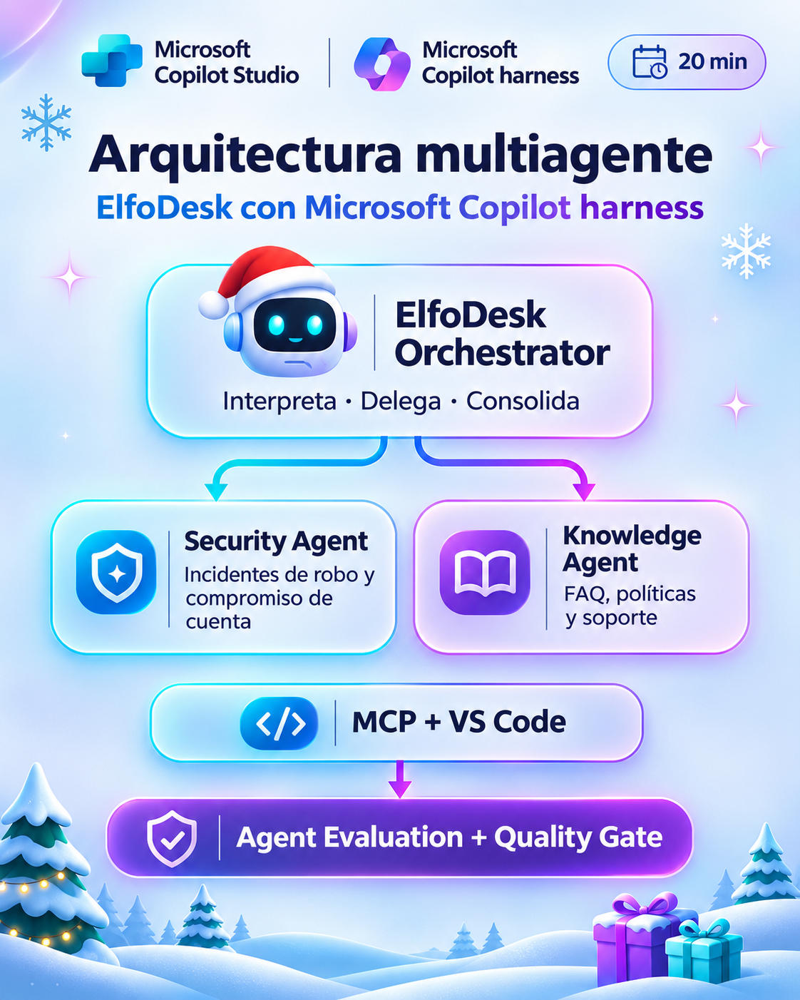
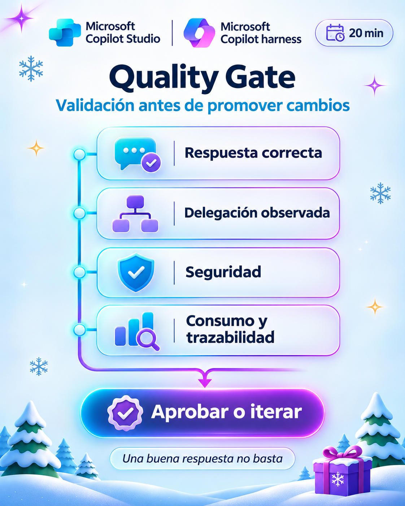

# 🎄 ElfoDesk: del low-code al pro-code a golpe de villancico

### Copilot Studio · VS Code · GitHub Copilot · MCP · Agent Evaluation

¿Qué ocurre cuando un agente de Copilot Studio se escapa del diseñador visual y acaba en VS Code justo antes de Navidad? 🎅🏻💻

Pues que empieza la verdadera magia.

**ElfoDesk** es una demo práctica de *Agent Engineering* en la que combinamos **Microsoft Copilot Studio, GitHub Copilot, VS Code y MCP** para entender, evolucionar y evaluar un sistema multiagente sin tener que elegir entre low-code y pro-code.

Aquí no venimos a enfrentar dos mundos.

Venimos a ponerlos a trabajar juntos. ✨

🎁 **Nuestro pequeño taller de elfos incluye:**

- 🧝‍♀️ un orquestador que decide quién debe resolver cada petición
- 🔐 un agente especializado en seguridad
- 📚 un agente especializado en conocimiento
- 🤖 IA ayudándonos desde VS Code
- 🔎 trazas para comprobar qué ha ocurrido realmente
- ✅ evaluación para descubrir si nuestros agentes se han portado bien… o merecen carbón

> 💡 **La idea:** una buena respuesta no significa necesariamente una buena arquitectura.  
> Queremos saber **qué agente actuó, por qué lo hizo y si podemos demostrarlo**.

**Low-code cuando nos hace la vida más fácil. Pro-code cuando necesitamos más control. IA para ayudarnos durante el camino.**

Y algún que otro villancico, porque estamos en Navidad. 🎄✨



## 🎁 ¿Qué vamos a desenvolver?

Todo empieza con una petición aparentemente sencilla a nuestro pequeño servicio de soporte navideño.

El problema es que detrás hay **varias intenciones, varios agentes y más de una decisión que tomar**.

A partir de ahí veremos cómo:

- 🎄 **Copilot Studio** orquesta un pequeño equipo de agentes especializados
- 💻 **VS Code + GitHub Copilot** nos ayudan a entender y evolucionar lo que estamos construyendo
- 🔌 **MCP** conecta ambos mundos
- 🧪 **Agent Evaluation + trazas** nos permiten comprobar si el sistema funciona de verdad y no solo si la respuesta “parece buena”

### El viaje

**Copilot Studio → VS Code + IA → mejora → evaluación → evidencia**

Porque en Agent Engineering el objetivo no es simplemente que el agente responda.

El objetivo es **poder confiar en cómo ha llegado hasta esa respuesta**. ✨

> 🎯 **Lo diferencial:** una respuesta buena no demuestra por sí sola que la delegación sea correcta. Queremos comprobar qué agente actuó, qué decisión tomó el orquestador y qué evidencia tenemos para demostrarlo.

**¿Quieres reproducir la demo?**  
[Runbook paso a paso](docs/09-runbook-paso-a-paso.md) · [Guion de la sesión](docs/10-guion-del-ponente.md) · [Checklist técnico](docs/00-checklist-20min.md)

## 🧠 Tres componentes con responsabilidades claras

| Componente | Responsabilidad |
|---|---|
| **ElfoDesk Orchestrator** | Interpreta, decide delegación y consolida resultados |
| **Security Agent** | Robo/pérdida, seguridad de cuentas, escalado **orientativo** |
| **Knowledge Agent** | FAQ, horarios, procedimientos de recuperación y soporte |

Son agentes separados de **Microsoft Copilot harness** (nombre actual del antiguo *GitHub Copilot harness*). No confundas el runtime con **GitHub Copilot**, que usamos como asistente de programación.

**Conectividad:** preparar los dos especialistas en el mismo entorno, publicarlos y habilitar su conexión; conectar después desde el agente principal. Confirmar permisos de todos los agentes para quienes participen en la demo.

## ⚙️ Cómo reproducir la demo

1. **Preparar DEV** con Microsoft Copilot harness y permisos de publicación/connected agents.
2. Crear y publicar **Security Agent** y **Knowledge Agent** con las [especificaciones ficticias](multiagent/agents/); configurarlos como conectables.
3. Crear **ElfoDesk Orchestrator**, vincular ambos especialistas en **Build → Connected agents** y revisar permisos.
4. Ensayar tres consultas y comprobar **delegación observable** desde Preview (seguridad, FAQ y consulta mixta).
5. Conectar **GitHub Copilot en VS Code** al servidor **Copilot Studio MCP** y confirmar DEV / herramientas disponibles antes de modificar nada.
6. Preparar **Evaluate** con cinco casos, ejecutar un ensayo y registrar resultados **reales** y trazas por separado.
7. Ejecutar el guion de 20 minutos con pantallas y evaluación ya abiertas; usar un vídeo del ensayo claramente identificado como respaldo.

Consulta el [runbook operativo completo](docs/09-runbook-paso-a-paso.md) para los pasos exactos, prompts, controles de seguridad y resolución de problemas.

## 🖼️ Carrusel original · Microsoft + Navidad

La galería principal recupera los **cuatro diseños ilustrados originales** elegidos para la sesión: fondos claros, colores Microsoft, motivos navideños y jerarquía visual pensada para presentar en 20 minutos.

| 1. Arquitectura multiagente | 2. Flujo de desarrollo y MCP |
|:---:|:---:|
| [](assets/carousel/originals/10-arquitectura-original.jpg) | [](assets/carousel/originals/11-flujo-mcp-original.jpg) |
| **3. Agent Evaluation** | **4. Quality Gate** |
| [](assets/carousel/originals/12-evaluacion-original.jpg) | [](assets/carousel/originals/13-quality-gate-original.jpg) |

Estas ilustraciones son **JPG optimizados de las imágenes generadas originalmente**, sin sustituir su composición por diagramas genéricos. Representan **arquitecturas y objetivos**, no ejecuciones verificadas en un tenant ni scores reales. Los símbolos y denominaciones de producto son recursos visuales; la demo no está patrocinada por Microsoft.

### Diagramas técnicos editables

Mantenemos separadamente los [SVG versionados y sus PNG exportados automáticamente](assets/carousel/README.md) para documentación técnica, cambios futuros y slides de arquitectura. Las ilustraciones anteriores son la **versión visual preferente del README**.

## 📂 Material reproducible

- [Tres especificaciones de agentes](multiagent/agents/) · [Contrato de delegación](multiagent/delegation-contract.md)
- [Preparación, permisos y MCP](docs/04-preparacion-tecnica.md)
- [Prompts para el cliente MCP](multiagent/prompts/)
- [Ocho escenarios multiagente](multiagent/evaluation/delegation-matrix.csv)
- [CSV para preparar Agent Evaluation](multiagent/evaluation/copilot-harness-conversations.csv) · [Rúbrica](multiagent/evaluation/rubric.md)
- [**Runbook de ejecución**](docs/09-runbook-paso-a-paso.md) · [Guion para el ponente](docs/10-guion-del-ponente.md) · [Evidencias](docs/07-evidencias-demo.md)
- [Laboratorio legado Standard harness](legacy-standard/README.md), mantenido como referencia técnica

## ✅ Validación local

```bash
python3 multiagent/validate.py
python3 -m unittest discover -s tests -p 'test_*.py' -v
```

La validación local comprueba **archivos y escenarios**, no invoca Copilot Studio. Las pruebas reales deben ejecutarse sobre el orquestador configurado en DEV; la pestaña Evaluate del nuevo harness puede requerir créditos y su disponibilidad depende del tenant. No presentar metas como resultados.

## 🧪 Antes de encender las luces del árbol...

> **Estado:** este repositorio contiene el material de preparación de la demo, no un tenant desplegado.
>
> Los tres agentes y su conexión deben crearse previamente en **Copilot Studio DEV**. Los CSV incluyen escenarios **sintéticos**, no resultados medidos.
>
> La edición YAML de la extensión clásica corresponde al **Standard harness** y se mantiene únicamente como laboratorio legado; **no forma parte de la demo principal**.

## 🔐 Seguridad y límites

Sin datos reales de clientes, tokens ni credenciales. Ningún ejemplo bloquea dispositivos, modifica cuentas, envía correos, abre tickets o publica agentes automáticamente. Toda mutación vía MCP necesita aprobación y comprobación del contrato real de herramientas.

## Documentación oficial

- [Conectar agentes Copilot Studio](https://learn.microsoft.com/en-us/microsoft-copilot-studio/agents-experience/add-agent-connected)
- [MCP oficial de Copilot Studio](https://learn.microsoft.com/en-us/microsoft-copilot-studio/agents-experience/copilot-studio-mcp)
- [Crear evaluaciones](https://learn.microsoft.com/en-us/microsoft-copilot-studio/agents-experience/analytics-agent-evaluation-create)
- [Elegir harness](https://learn.microsoft.com/en-us/microsoft-copilot-studio/guidance/choose-harness)

**Licencia:** pendiente de definir; este repositorio no concede automáticamente licencia de código abierto.
