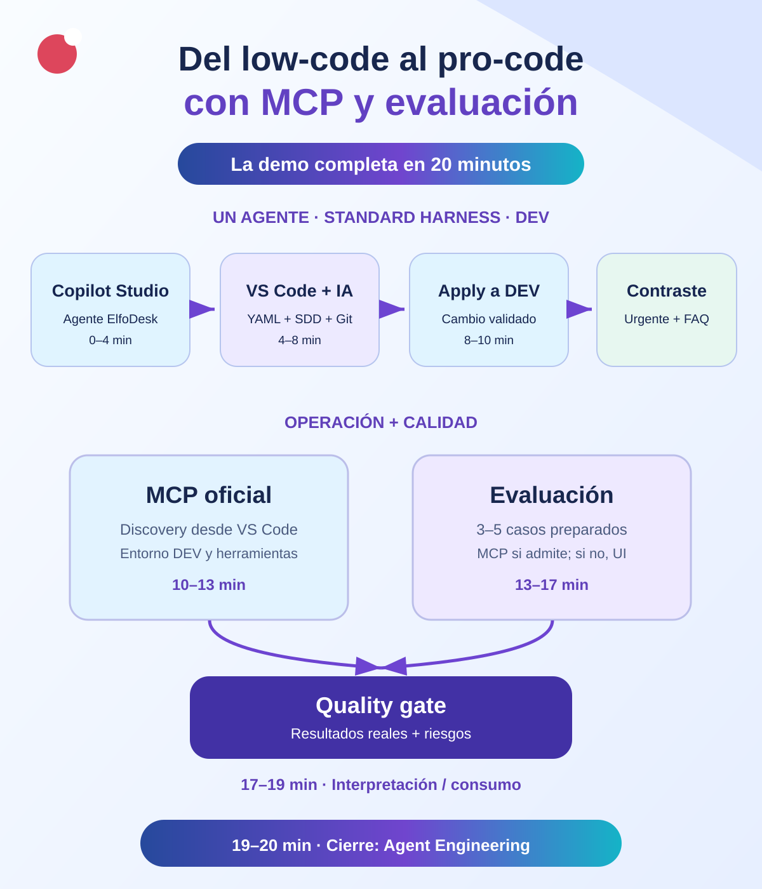
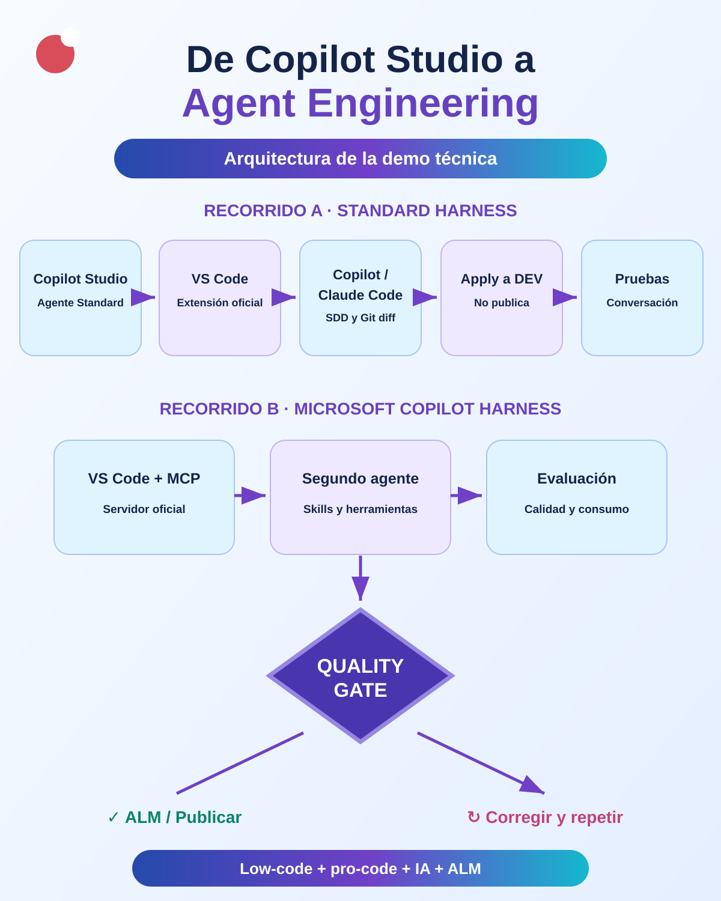
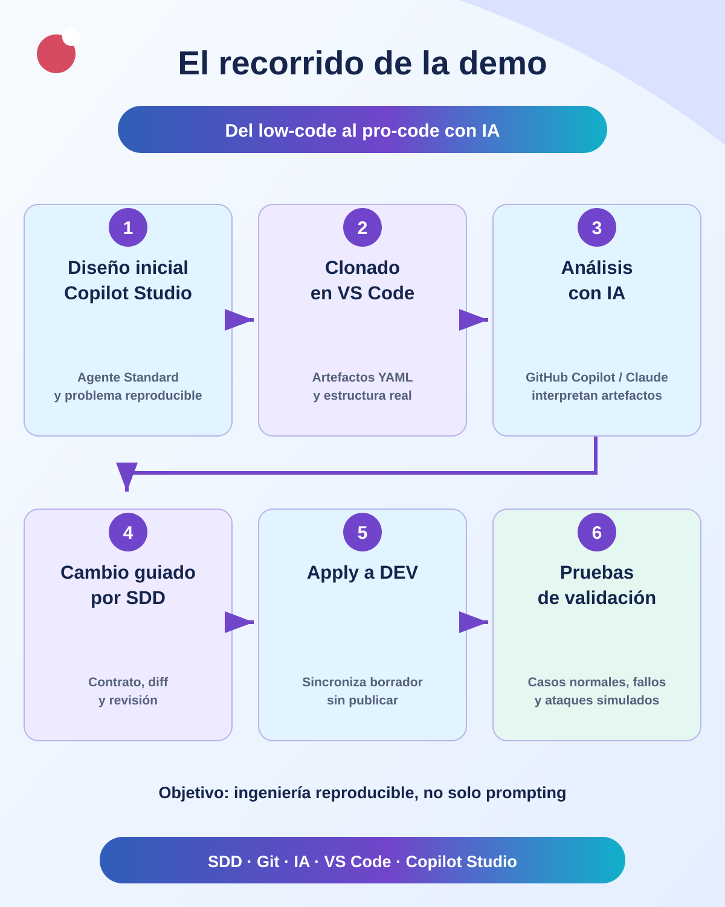
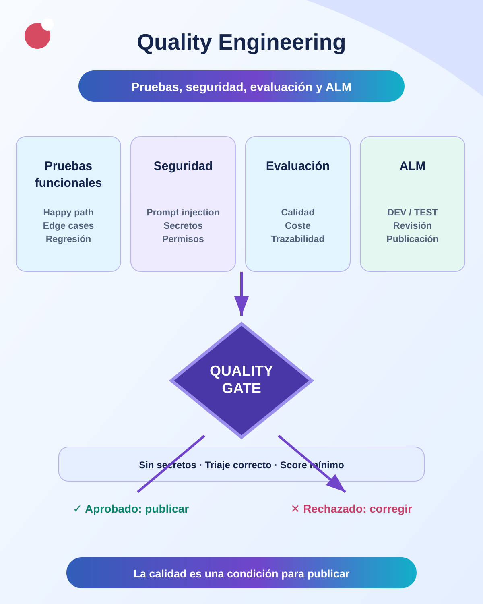
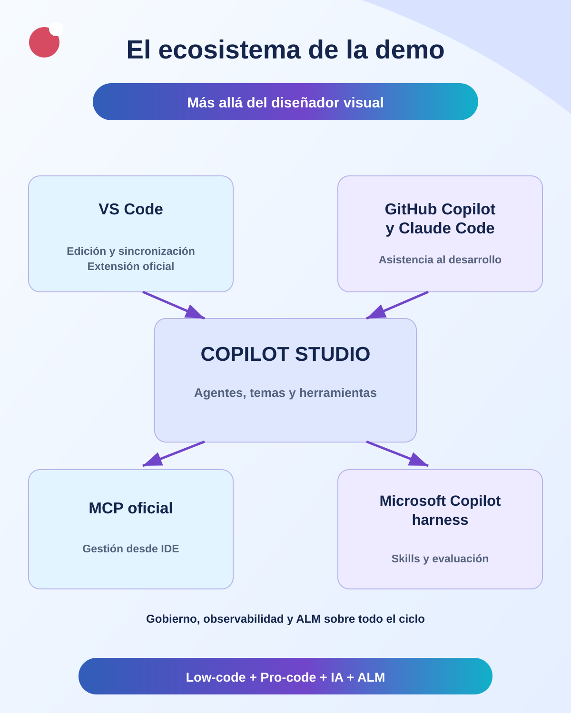

# 🎄 Del low-code al pro-code a golpe de villancico
## Copilot Studio + VS Code + IA + MCP + Evaluación · **20 minutos**



**Una historia, un agente y un resultado verificable.** Vamos a evolucionar **ElfoDesk**, un agente ficticio de soporte IT construido en Copilot Studio (**Standard harness**), editar su definición en Visual Studio Code con asistencia de IA, revisar el cambio con Git y **Apply** en DEV. Después usaremos **Copilot Studio MCP** para descubrir recursos desde VS Code y una **evaluación real** para medir si el cambio funciona.

> **Estado:** kit de preparación con datos sintéticos. No contiene un agente exportado de un tenant ni resultados de evaluación cloud. Las funciones MCP disponibles dependen del cliente, del entorno y de los permisos. Si MCP no ofrece evaluación, se usa el evaluador de Copilot Studio para Standard harness, preparado de antemano.

## 🎯 Agenda del directo — 20 minutos

| Minutos | Bloque | Qué se ve |
|---|---|---|
| **0–2** | Problema | Consulta de robo de portátil y respuesta inicial reproducible |
| **2–4** | Low-code → pro-code | Tema de Copilot Studio y YAML **ya clonado** en VS Code |
| **4–8** | SDD + IA + Git | Cambio pequeño con GitHub Copilot o Claude Code, diff y validación |
| **8–10** | Apply a DEV | Sincronizar **borrador**, repetir consulta urgente y FAQ |
| **10–13** | **MCP oficial** | Desde VS Code: identidad/DEV, discovery del agente y capacidades disponibles |
| **13–17** | **Evaluación** | Suite preparada de 3–5 casos, ejecutar/consultar resultados reales |
| **17–19** | Quality gate | Interpretar fallos, seguridad y consumo si está disponible |
| **19–20** | Cierre | El valor de Agent Engineering y repositorio |

**Clave:** no instalamos nada, no clonamos desde cero y no creamos un segundo agente en directo. Si existe una operación de evaluación por MCP y está validada, se utiliza; si no, **MCP y evaluación se demuestran por separado**. Ninguna publicación automática.

[**Guion minuto a minuto**](docs/02-guion-directo.md) · [**Checklist de ensayo y plan B**](docs/00-checklist-20min.md) · [**Arquitectura Mermaid**](docs/03-arquitectura.md)

## 🧪 Qué vamos a evaluar

Tres preguntas visibles: **incidente crítico**, **FAQ normal** y **petición insegura de MFA**. La mini suite recomendada incluye cinco escenarios (`URG-01`, `FAQ-01`, `SEC-02`, `ADV-01`, `NEG-01`) de [18 casos sintéticos](tests/casos_v2.csv). El CSV sirve para preparar tests; **no** es necesariamente el formato de importación de Copilot Studio.

La evaluación completa, el segundo harness, Foundry, Agent Framework, ALM y FinOps se mantienen como material avanzado para después de la charla.

## 🖼️ Carrusel de apoyo

Los cuatro diagramas siguientes corresponden a una **arquitectura extendida**, no a cuatro tareas que ejecutaremos en 20 minutos.

| Arquitectura extendida | Recorrido extendido |
|:---:|:---:|
| [](assets/carousel/01-arquitectura.svg) | [](assets/carousel/02-recorrido-demo.svg) |
| **Quality Engineering** | **Ecosistema** |
| [](assets/carousel/03-quality-engineering.svg) | [](assets/carousel/04-ecosistema.svg) |

Son SVG versionables; los PNG del carrusel navideño no están alojados aquí.

## 📁 Contenido

- **[Guion 20 min](docs/02-guion-directo.md)** y **[checklist](docs/00-checklist-20min.md)**, con tiempos y contingencias.
- [Contrato SDD](docs/05-sdd-contrato.md), [prompts para la IA](prompts/) y [documentación de arquitectura](docs/03-arquitectura.md).
- [Preparación técnica MCP, VS Code y evaluación](docs/04-preparacion-tecnica.md).
- [Pruebas](tests/) y [registro de evidencias](docs/07-evidencias-demo.md).
- [Calidad, seguridad y FinOps](docs/06-alm-seguridad-costes.md), [novedades](docs/01-novedades-verificadas.md) y [ecosistema extendido](docs/08-ecosistema-extendido.md).
- [Contenido ficticio del agente](samples/) y [configuración MCP opcional](.vscode/mcp.example.json).

## ✅ Validación local (no cloud)

```bash
python3 tests/validar_matriz.py
python3 -m unittest discover -s tests -p 'test_*.py' -v
```

Estos comandos **solo validan el kit**, no ejecutan ni evalúan conversaciones reales. **Apply ≠ Publish**. Todos los cambios cloud deben ejecutarse en DEV, con revisión de permisos, datos sintéticos y confirmación humana.

## Documentación oficial

- [Extensión Copilot Studio para VS Code](https://learn.microsoft.com/en-us/microsoft-copilot-studio/visual-studio-code-extension-overview)
- [Sincronización de cambios](https://learn.microsoft.com/en-us/microsoft-copilot-studio/visual-studio-code-extension-synchronization)
- [Servidor MCP oficial](https://learn.microsoft.com/en-us/microsoft-copilot-studio/agents-experience/copilot-studio-mcp)
- [Evaluación de agentes](https://learn.microsoft.com/en-us/microsoft-copilot-studio/analytics-agent-evaluation-overview)
- [Diferencias entre harnesses](https://learn.microsoft.com/en-us/microsoft-copilot-studio/guidance/choose-harness)

**Licencia:** pendiente de decidir; el repositorio no concede automáticamente una licencia de código abierto.
