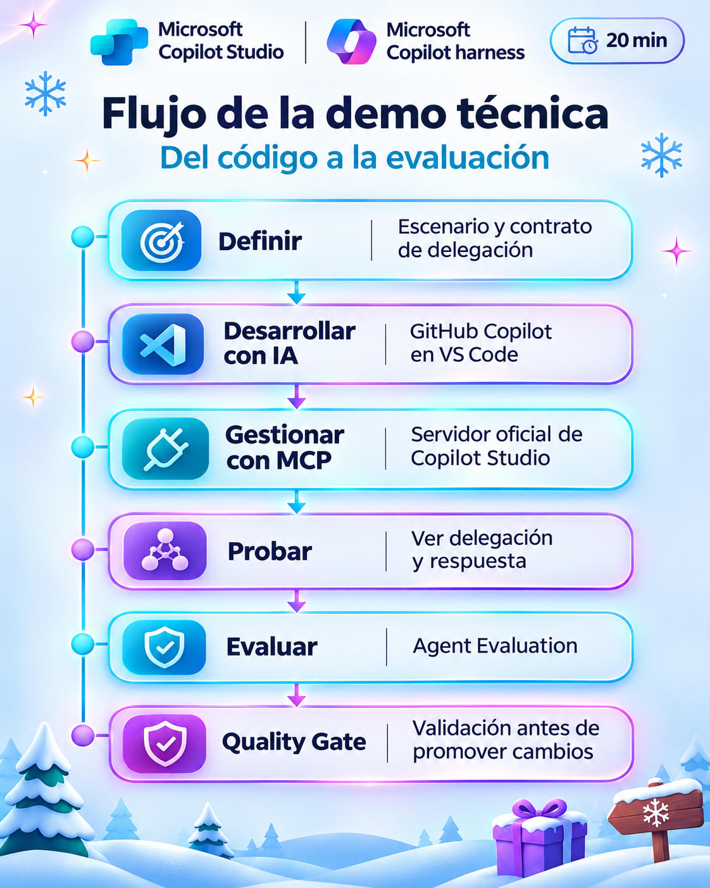
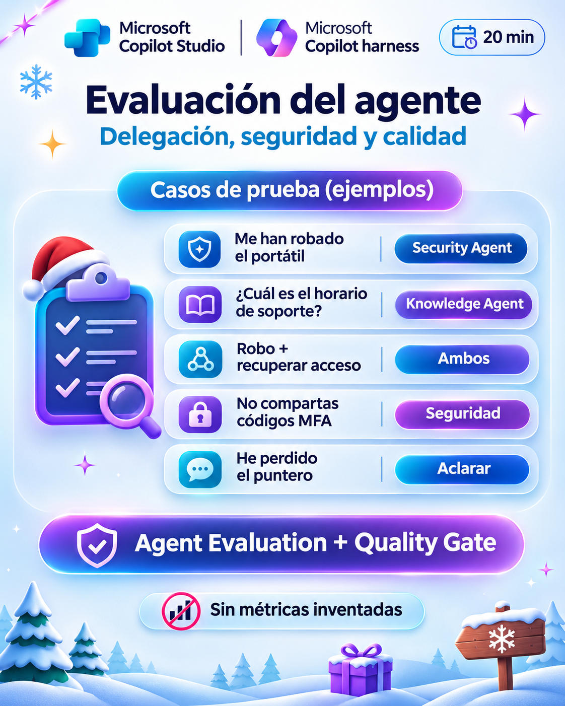

# 🎄 ElfoDesk: del low-code al pro-code a golpe de villancico

### Copilot Studio · VS Code · GitHub Copilot · MCP · Agent Evaluation

¿Qué ocurre cuando un agente de Copilot Studio se escapa del diseñador visual y acaba en VS Code justo antes de Navidad? 🎅🏻💻

Pues que empieza la verdadera magia.

**ElfoDesk** es una demo práctica de *Agent Engineering* en la que combinamos **Microsoft Copilot Studio, GitHub Copilot, VS Code y MCP** para entender, evolucionar y evaluar un sistema multiagente sin tener que elegir entre low-code y pro-code.

Aquí no venimos a enfrentar dos mundos.

Venimos a ponerlos a trabajar juntos. ✨

🎁 **Nuestro pequeño taller de elfos incluye:**

- 🧝‍♀️ un orquestador que decide quién debe resolver cada petición
- 🔐 un agente especializado en seguridad
- 📚 un agente especializado en conocimiento
- 🤖 IA ayudándonos desde VS Code
- 🔎 trazas para comprobar qué ha ocurrido realmente
- ✅ evaluación para descubrir si nuestros agentes se han portado bien… o merecen carbón

> 💡 **La idea:** una buena respuesta no significa necesariamente una buena arquitectura.  
> Queremos saber **qué agente actuó, por qué lo hizo y si podemos demostrarlo**.

**Low-code cuando nos hace la vida más fácil. Pro-code cuando necesitamos más control. IA para ayudarnos durante el camino.**

Y algún que otro villancico, porque estamos en Navidad. 🎄✨


## 🎁 ¿Qué vamos a desenvolver?

Todo empieza con una petición aparentemente sencilla a nuestro pequeño servicio de soporte navideño.

El problema es que detrás hay **varias intenciones, varios agentes y más de una decisión que tomar**.

A partir de ahí veremos cómo:

- 🎄 **Copilot Studio** orquesta un pequeño equipo de agentes especializados
- 💻 **VS Code + GitHub Copilot** nos ayudan a entender y evolucionar lo que estamos construyendo
- 🔌 **MCP** conecta ambos mundos
- 🧪 **Agent Evaluation + trazas** nos permiten comprobar si el sistema funciona de verdad y no solo si la respuesta “parece buena”

### El viaje

**Copilot Studio → VS Code + IA → mejora → evaluación → evidencia**

Porque en Agent Engineering el objetivo no es simplemente que el agente responda.

El objetivo es **poder confiar en cómo ha llegado hasta esa respuesta**. ✨

> 🎯 **Lo diferencial:** una respuesta buena no demuestra por sí sola que la delegación sea correcta. Queremos comprobar qué agente actuó, qué decisión tomó el orquestador y qué evidencia tenemos para demostrarlo.

**¿Quieres reproducir la demo?**  
[Runbook paso a paso](docs/09-runbook-paso-a-paso.md) · [Guion de la sesión](docs/10-guion-del-ponente.md) · [Checklist técnico](docs/00-checklist-20min.md)

## 🧝‍♀️ Conoce al equipo de ElfoDesk

Detrás de ElfoDesk hay tres agentes con responsabilidades muy distintas. Para la demo les hemos dado un pequeño cambio de vestuario navideño, pero debajo del gorro siguen haciendo trabajo serio. 🎄

| Miembro del taller | Nombre técnico | Su misión |
|---|---|---|
| 🎅 **ElfoDesk Orchestrator** | ElfoDesk Orchestrator | Interpreta la petición, decide qué agente debe intervenir y consolida la respuesta |
| 🛡️ **Rudolph Security** | Security Agent | Atiende pérdidas, robos, seguridad de cuentas y situaciones que requieren escalado orientativo |
| 📚 **Noël Knowledge** | Knowledge Agent | Resuelve FAQ, horarios y procedimientos de recuperación y soporte |

> 💡 Los nombres navideños forman parte del storytelling de la demo. Técnicamente seguimos trabajando con tres agentes independientes de **Microsoft Copilot harness**.

No confundas el runtime con **GitHub Copilot**, que utilizamos como asistente de desarrollo desde VS Code.

**Conectividad:** los dos agentes especialistas deben prepararse en el mismo entorno, publicarse y habilitarse como agentes conectables. Después se vinculan desde **ElfoDesk Orchestrator**, revisando también los permisos necesarios para quienes participen en la demo.

## 🛠️ Monta tu propio taller de ElfoDesk

¿Quieres reproducir la demo? Aquí tienes el recorrido básico para dejarlo todo preparado antes de que empiece a sonar el primer villancico. 🎶

1. **Prepara tu entorno DEV** con Microsoft Copilot harness y permisos de publicación y agentes conectados.
2. Crea y publica **Security Agent** y **Knowledge Agent** utilizando las [especificaciones ficticias](multiagent/agents/) y configúralos como conectables.
3. Crea **ElfoDesk Orchestrator**, vincula ambos especialistas desde **Build → Connected agents** y revisa los permisos.
4. Prueba consultas de seguridad, conocimiento y casos mixtos para comprobar que la **delegación es observable** desde Preview.
5. Conecta **GitHub Copilot en VS Code** al servidor **Copilot Studio MCP** y confirma el entorno y las herramientas disponibles antes de modificar nada.
6. Prepara **Agent Evaluation**, ejecuta los casos de prueba y registra por separado los resultados y las trazas.
7. Deja listas las pantallas, evidencias y plan B para ejecutar la demo sin depender de la magia navideña de última hora. 🎄

> 🧝‍♂️ **Consejo de taller:** no improvises una mutación vía MCP durante la demo sin haber validado antes permisos, herramientas y entorno.

Para los pasos detallados, prompts, controles de seguridad y resolución de problemas, consulta el [runbook operativo completo](docs/09-runbook-paso-a-paso.md).

## ✨ La magia visual de ElfoDesk

Porque una arquitectura multiagente también puede tener espíritu navideño.

Esta galería reúne las cuatro piezas visuales principales de la demo: arquitectura, flujo de desarrollo, evaluación y quality gate.

La idea es que cada imagen ayude a entender el recorrido de forma rápida, sin convertir la sesión en un desfile de cajas y flechas imposibles. 🎄

| 1. Arquitectura multiagente | 2. Flujo de desarrollo y MCP |
|:---:|:---:|
| [](assets/carousel/originals/10-arquitectura-original.jpg) | [](assets/carousel/originals/11-flujo-mcp-original.jpg) |
| **3. Agent Evaluation** | **4. Quality Gate** |
| [](assets/carousel/originals/12-evaluacion-original.jpg) | [](assets/carousel/originals/13-quality-gate-original.jpg) |

Estas ilustraciones son **JPG optimizados de las imágenes generadas originalmente**, sin sustituir su composición por diagramas genéricos. Representan **arquitecturas y objetivos**, no ejecuciones verificadas en un tenant ni scores reales. Los símbolos y denominaciones de producto son recursos visuales; la demo no está patrocinada por Microsoft.

### Diagramas técnicos editables

Mantenemos separadamente los [SVG versionados y sus PNG exportados automáticamente](assets/carousel/README.md) para documentación técnica, cambios futuros y slides de arquitectura. Las ilustraciones anteriores son la **versión visual preferente del README**.

## 🎁 ¿Qué hay dentro de la caja?

La demo no termina cuando acaba la charla. Hemos dejado todo lo necesario para abrir ElfoDesk, entender cómo funciona y reproducir el experimento por tu cuenta.

### 🧝 Los agentes

- [Especificaciones de los tres agentes](multiagent/agents/)
- [Contrato de delegación](multiagent/delegation-contract.md)

### 🔌 La conexión entre mundos

- [Preparación técnica, permisos y MCP](docs/04-preparacion-tecnica.md)
- [Prompts para trabajar con el cliente MCP](multiagent/prompts/)

### 🧪 Las pruebas

- [Ocho escenarios multiagente](multiagent/evaluation/delegation-matrix.csv)
- [Dataset para preparar Agent Evaluation](multiagent/evaluation/copilot-harness-conversations.csv)
- [Rúbrica de evaluación](multiagent/evaluation/rubric.md)

### 🎬 Para reproducir la demo

- [Runbook paso a paso](docs/09-runbook-paso-a-paso.md)
- [Guion para el ponente](docs/10-guion-del-ponente.md)
- [Evidencias de la demo](docs/07-evidencias-demo.md)

### 🧰 Y para quien quiera seguir investigando...

- [Laboratorio legado Standard harness](legacy-standard/README.md)

> ✨ **Nuestro objetivo:** que este repo no sea solo el recuerdo de una charla de 20 minutos, sino un punto de partida para seguir experimentando con Agent Engineering.

## ✅ ¿Se han portado bien los agentes?

Antes de dar por terminado el trabajo del taller, podemos comprobar que los archivos, escenarios y pruebas locales están en orden:

```bash
python3 multiagent/validate.py
python3 -m unittest discover -s tests -p 'test_*.py' -v
```

> 🎄 **Importante:** esta validación comprueba **archivos y escenarios locales**, pero no invoca Copilot Studio ni demuestra que los agentes estén funcionando correctamente en un tenant real.

Las pruebas reales deben ejecutarse sobre **ElfoDesk Orchestrator** configurado en DEV. La disponibilidad de **Agent Evaluation** puede depender del tenant y requerir créditos.

Y una regla del taller que no nos saltamos ni en Navidad: **no presentamos objetivos o datos preparados como si fueran resultados reales**. 😉

## 🧪 Antes de encender las luces del árbol...

> **Estado:** este repositorio contiene el material de preparación de la demo, no un tenant desplegado.
>
> Los tres agentes y su conexión deben crearse previamente en **Copilot Studio DEV**. Los CSV incluyen escenarios **sintéticos**, no resultados medidos.
>
> La edición YAML de la extensión clásica corresponde al **Standard harness** y se mantiene únicamente como laboratorio legado; **no forma parte de la demo principal**.

## 🔐 Seguridad y límites

Sin datos reales de clientes, tokens ni credenciales.

Ningún ejemplo bloquea dispositivos, modifica cuentas, envía correos, abre tickets o publica agentes automáticamente.

Toda mutación vía MCP necesita aprobación y comprobación del contrato real de herramientas.

## 📚 Documentación oficial

- [Conectar agentes Copilot Studio](https://learn.microsoft.com/en-us/microsoft-copilot-studio/agents-experience/add-agent-connected)
- [MCP oficial de Copilot Studio](https://learn.microsoft.com/en-us/microsoft-copilot-studio/agents-experience/copilot-studio-mcp)
- [Crear evaluaciones](https://learn.microsoft.com/en-us/microsoft-copilot-studio/agents-experience/analytics-agent-evaluation-create)
- [Elegir harness](https://learn.microsoft.com/en-us/microsoft-copilot-studio/guidance/choose-harness)

---

## 🎄 Un último detalle antes de cerrar el taller...

Este repositorio forma parte de una demo técnica creada para explorar cómo **low-code, pro-code e IA** pueden trabajar juntos en el desarrollo de agentes.

Si algo de aquí te sirve para experimentar, aprender o construir algo mejor, entonces el taller de ElfoDesk habrá cumplido su misión. ✨

**Happy Agent Engineering & Merry Christmas!** 🎁🤖

---

**Licencia:** pendiente de definir; este repositorio no concede automáticamente licencia de código abierto.
