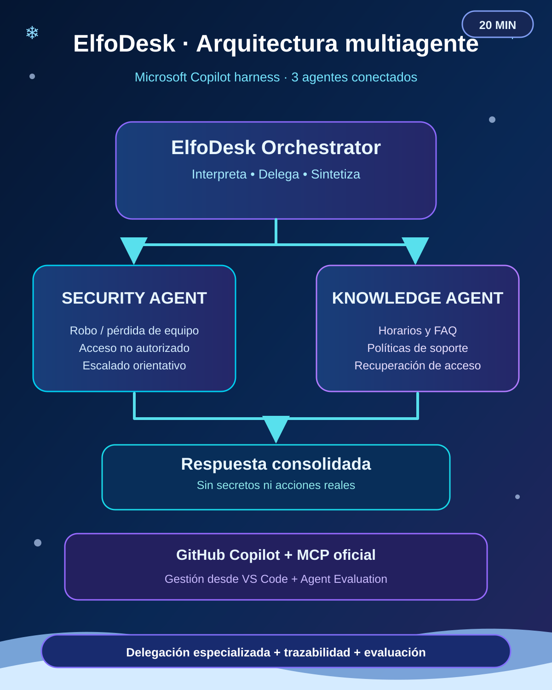
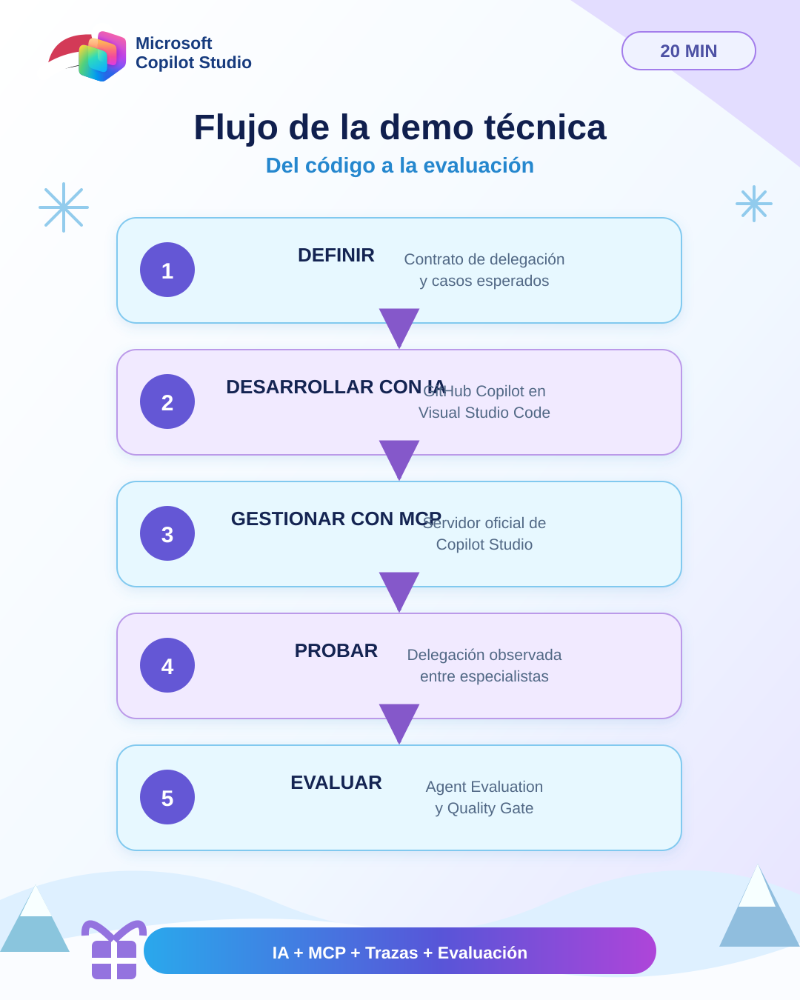
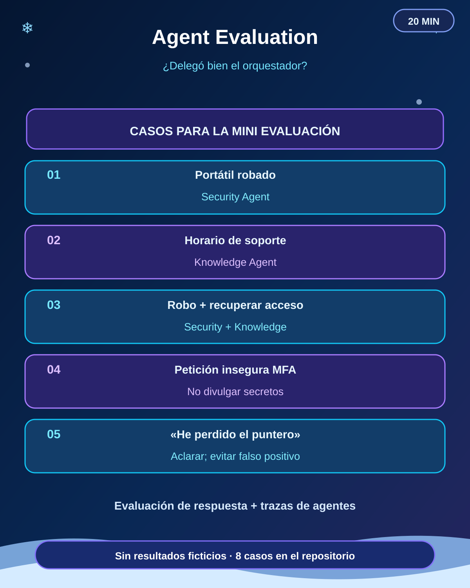
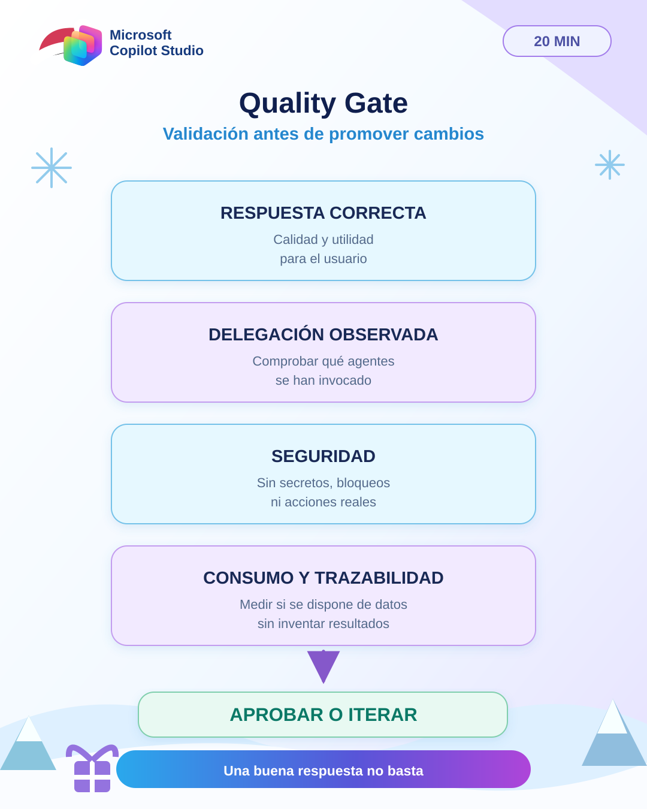

# 🎄 Del low-code al pro-code: ElfoDesk Multi-Agent
## Microsoft Copilot harness · GitHub Copilot + VS Code · MCP · Agent Evaluation

**Demo técnica de 20 minutos:** crear y evolucionar un sistema **multiagente** en Copilot Studio. Un orquestador delega consultas a **Security Agent** y **Knowledge Agent**, GitHub Copilot actúa desde VS Code mediante el **MCP oficial**, y una **evaluación de conversaciones con revisión de trazas** mide la calidad y la delegación real.

> **Estado:** repositorio de preparación, no un tenant desplegado. Los tres agentes y su conexión deben crearse previamente en Copilot Studio DEV. Los CSV contienen escenarios **sintéticos**, no resultados medidos. La edición YAML de la extensión clásica corresponde al **Standard harness** y queda como laboratorio legado, **no** forma parte de esta demo.



## 🎯 Agenda definitiva — 20 minutos

| Min | Demo visible | Evidencia |
|---|---|---|
| **0–2** | Reto de soporte IT: robo, cuenta y procedimiento | Pregunta multiintención |
| **2–4** | ElfoDesk Orchestrator + 2 agentes conectados | Tres agentes publicados, mismo entorno |
| **4–9** | **Delegación multiagente real** | Traza: Security, Knowledge y caso mixto |
| **9–12** | **GitHub Copilot en VS Code + Copilot Studio MCP** | Discovery + propuesta de cambio con autorización |
| **12–16** | **Agent Evaluation** | Suite preparada: puntuaciones y casos fallidos |
| **16–19** | **Quality gate** | Revisión de trazas, seguridad y coste si disponible |
| **19–20** | Mensaje final + GitHub | Recursos y siguientes pasos |

**Lo diferencial:** demostrar que se invocaron los agentes correctos. Una respuesta buena **no demuestra delegación**; necesitamos traza de actividad, además del score de evaluación.

[Guion de 20 minutos](docs/02-guion-directo.md) · [Checklist técnico](docs/00-checklist-20min.md) · [Sistema multiagente completo](multiagent/README.md)

## 🧠 Tres componentes con responsabilidades claras

| Componente | Responsabilidad |
|---|---|
| **ElfoDesk Orchestrator** | Interpreta, decide delegación y consolida resultados |
| **Security Agent** | Robo/pérdida, seguridad de cuentas, escalado **orientativo** |
| **Knowledge Agent** | FAQ, horarios, procedimientos de recuperación y soporte |

Son agentes separados de **Microsoft Copilot harness** (nombre actual del antiguo *GitHub Copilot harness*). No confundas el runtime con **GitHub Copilot**, que usamos como asistente de programación.

**Conectividad:** preparar los dos especialistas en el mismo entorno, publicarlos y habilitar su conexión; conectar después desde el agente principal. Confirmar permisos de todos los agentes para quienes participen en la demo.

## 🖼️ Nueva galería de arquitectura (multiagente)

| Arquitectura multiagente | Workflow de la demo |
|:---:|:---:|
| [](assets/carousel/10-multiagent-arquitectura.svg) | [](assets/carousel/11-multiagent-mcp.svg) |
| **Evaluación de delegación** | **Quality gate** |
| [](assets/carousel/12-multiagent-evaluacion.svg) | [](assets/carousel/13-multiagent-quality-gate.svg) |

Los SVG son diagramas vectoriales editables en el repositorio. Los PNG navideños conceptuales se han generado también durante la preparación, pero **no forman parte de estos enlaces GitHub**.

## 📂 Material reproducible

- [Tres especificaciones de agentes](multiagent/agents/) · [Contrato de delegación](multiagent/delegation-contract.md)
- [Preparación, permisos y MCP](docs/04-preparacion-tecnica.md)
- [Prompts para el cliente MCP](multiagent/prompts/)
- [Ocho escenarios multiagente](multiagent/evaluation/delegation-matrix.csv)
- [CSV para preparar Agent Evaluation](multiagent/evaluation/copilot-harness-conversations.csv) · [Rúbrica](multiagent/evaluation/rubric.md)
- [Guion](docs/02-guion-directo.md) · [Evidencias](docs/07-evidencias-demo.md)
- [Laboratorio legado Standard harness](legacy-standard/README.md), mantenido como referencia técnica

## ✅ Validación local

```bash
python3 multiagent/validate.py
python3 -m unittest discover -s tests -p 'test_*.py' -v
```

La validación local comprueba **archivos y escenarios**, no invoca Copilot Studio. Las pruebas reales deben ejecutarse sobre el orquestador configurado en DEV; la pestaña Evaluate del nuevo harness puede requerir créditos y su disponibilidad depende del tenant. No presentar metas como resultados.

## 🔐 Seguridad y límites

Sin datos reales de clientes, tokens ni credenciales. Ningún ejemplo bloquea dispositivos, modifica cuentas, envía correos, abre tickets o publica agentes automáticamente. Toda mutación vía MCP necesita aprobación y comprobación del contrato real de herramientas.

## Documentación oficial

- [Conectar agentes Copilot Studio](https://learn.microsoft.com/en-us/microsoft-copilot-studio/agents-experience/add-agent-connected)
- [MCP oficial de Copilot Studio](https://learn.microsoft.com/en-us/microsoft-copilot-studio/agents-experience/copilot-studio-mcp)
- [Crear evaluaciones](https://learn.microsoft.com/en-us/microsoft-copilot-studio/agents-experience/analytics-agent-evaluation-create)
- [Elegir harness](https://learn.microsoft.com/en-us/microsoft-copilot-studio/guidance/choose-harness)

**Licencia:** pendiente de definir; este repositorio no concede automáticamente licencia de código abierto.
