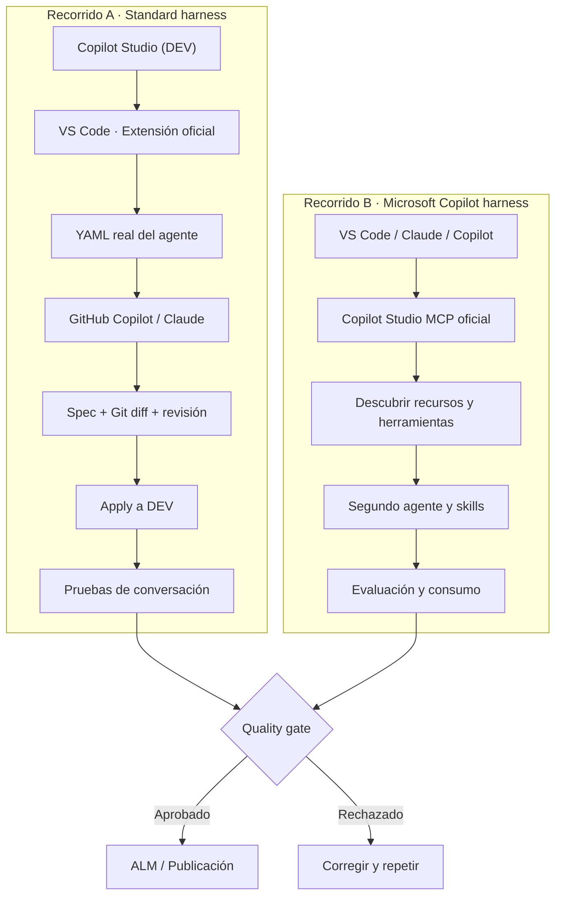

# Arquitectura de la demo

Los recorridos usan **dos agentes distintos**; la extensión de edición YAML no garantiza equivalencia con el nuevo harness.

Diagrama SVG: [arquitectura](../assets/carousel/01-arquitectura.svg).

