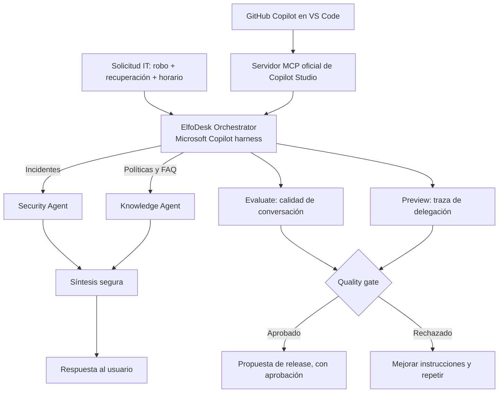

# Arquitectura — ElfoDesk Multi-Agent, Microsoft Copilot harness

**Distinguir protocolos:** Copilot Studio MCP permite a un cliente de desarrollo gestionar recursos. **Connected agents** resuelve la delegación interna entre agentes; no asumir que esas llamadas son automáticamente A2A externo.

Todos los agentes son independientes, del **nuevo Microsoft Copilot harness**. Para Connected agents comprobar publicación, mismo entorno, conectabilidad y permisos.

## Visuales
- [Arquitectura multiagente](../assets/carousel/10-multiagent-arquitectura.svg)
- [Flujo MCP](../assets/carousel/11-multiagent-mcp.svg)
- [Evaluación](../assets/carousel/12-multiagent-evaluacion.svg)
- [Quality gate](../assets/carousel/13-multiagent-quality-gate.svg)

## Alcance
El repo define agentes, delegación y pruebas en Markdown/CSV como referencia. **No** contiene una exportación de Copilot Studio ni habilita agentes desde GitHub por sí mismo. No ejecutar acciones reales de seguridad ni prometer métricas sin medir.
