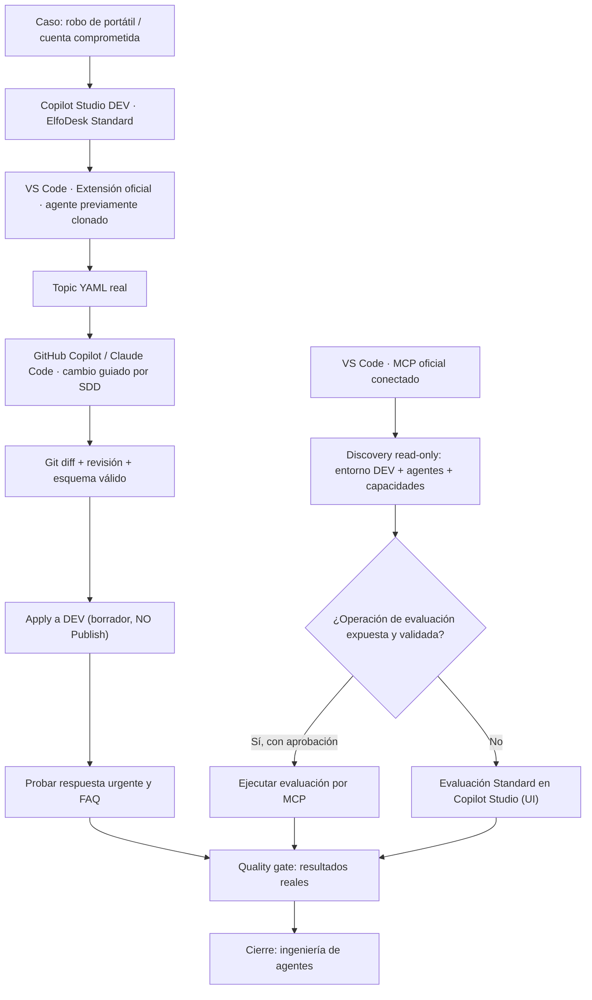

# Arquitectura de la demo (20 minutos)

La demo se centra en **un agente ElfoDesk Standard** con dos superficies complementarias: edición/versionado en VS Code y gestión/descubrimiento por MCP. La **evaluación es obligatoria como demostración**, pero no se presupone una operación MCP de evaluación: se utiliza la UI de evaluación Standard si el servidor MCP no la expone en el tenant.

**No se despliega un segundo agente ni se cambia de harness en directo.** El Microsoft Copilot harness, skills, Foundry y A2A se mantienen como ampliación documental.

## Apoyos visuales

- [Imagen específica de la sesión de 20 min](../assets/carousel/00-demo-20min.svg)
- [Arquitectura extendida](../assets/carousel/01-arquitectura.svg)
- [Quality Engineering](../assets/carousel/03-quality-engineering.svg)

## Qué NO hace esta arquitectura

- No implica que el MCP oficial siempre soporte ejecutar evaluaciones en todos los harnesses.
- No importa el CSV genérico de este repositorio automáticamente en Copilot Studio.
- No publica, bloquea dispositivos, cambia identidades ni abre incidencias reales.
